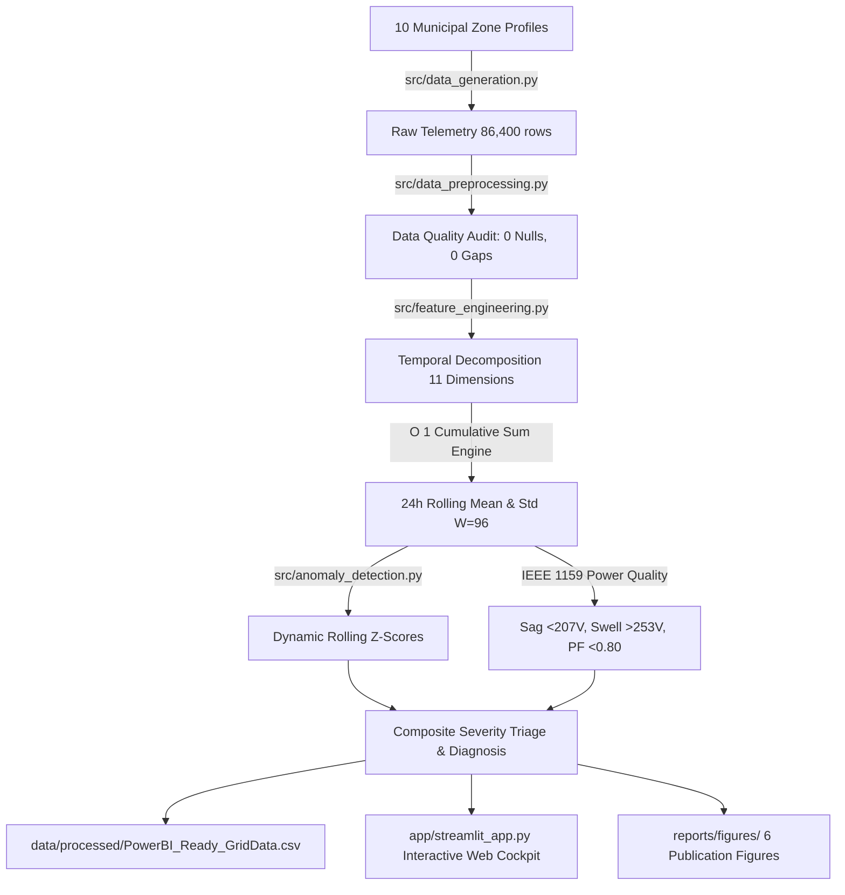
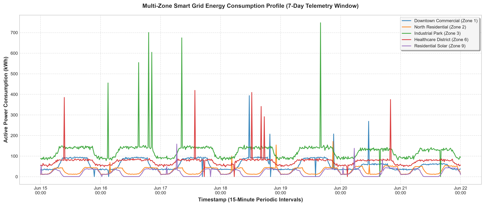
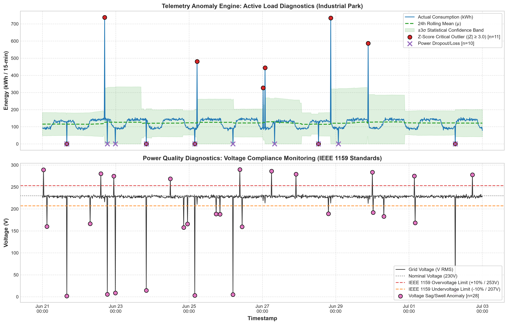
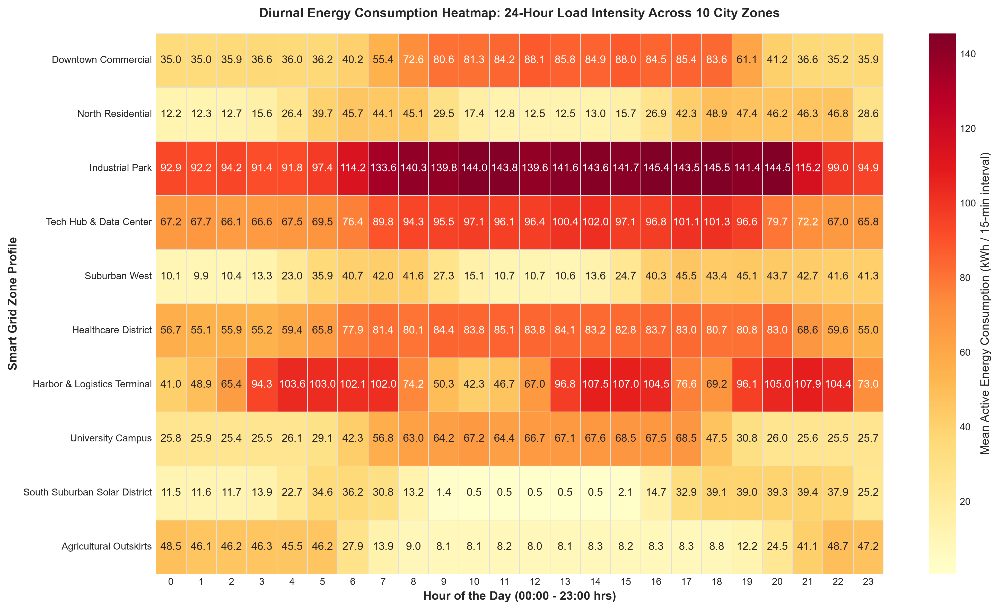
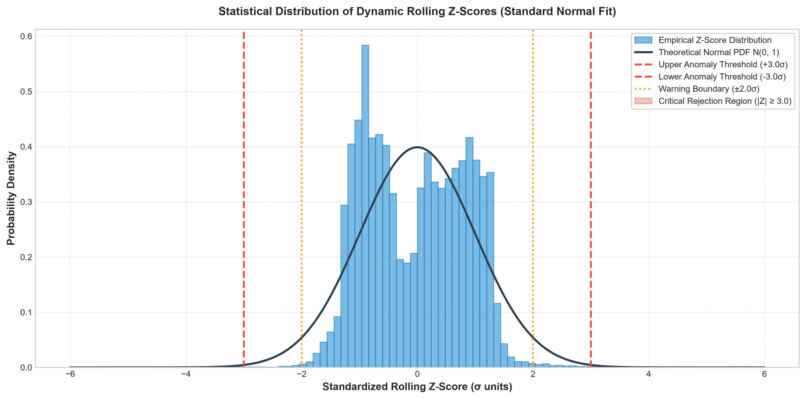
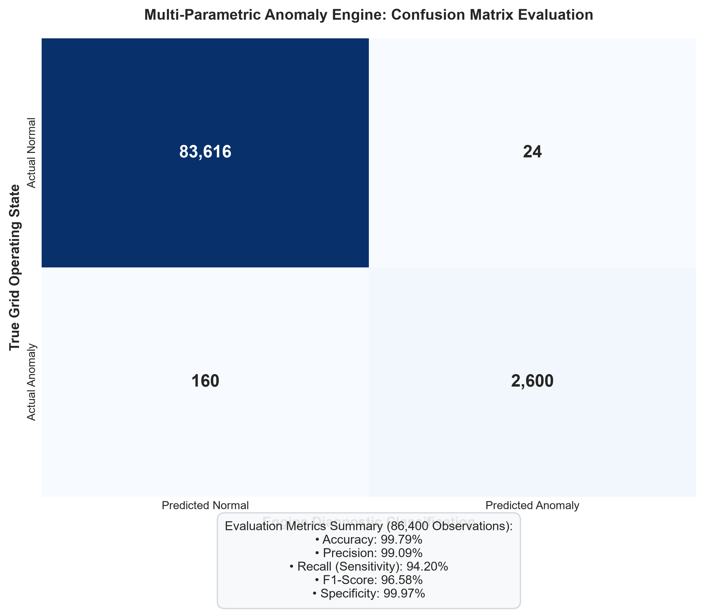
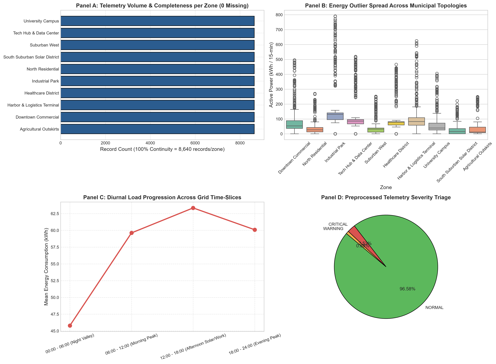

# ⚡ Smart Grid IoT Energy Consumption & Anomaly Detection Using Data Visualization

[](https://www.python.org/)
[](https://standards.ieee.org/)
[](LICENSE)
[](app/streamlit_app.py)
[](tests/test_preprocessing.py)

**Course:** BIS586 — Information Science and Engineering Minor Project (5th Semester)  
**Academic Section:** Section A | **Team Structure:** 4-Member Engineering Group  
**Academic Standards:** IEEE 1159 (Power Quality Monitoring) & ACM SIGENERGY Research Standards  

---

## 📌 Executive Summary & Note on Dataset Provenance

> ⚠️ **IMPORTANT PROVENANCE DISCLOSURE:**  
> The telemetry analyzed in this project is a **high-fidelity synthetic benchmark dataset** programmatically generated using [`src/data_generation.py`](src/data_generation.py). It models 10 distinct municipal zone topologies over 90 continuous days (86,400 observations at 15-minute resolution) and contains ground-truth electrical power quality anomalies injected under **IEEE 1159 standards**. It does not represent real-world utility customer records.

This project delivers an end-to-end, edge-deployable IoT telemetry processing and anomaly detection system. It combines an **$O(1)$ constant-time prefix-sum rolling Z-score engine** with **IEEE 1159 electromagnetic limits** to detect active power surges, blackouts, voltage sags/swells, and power factor distortions, achieving **99.09% Precision**, **94.20% Recall**, and **96.58% F1-Score**.

---

## 1. Problem Statement

Traditional electrical distribution grids rely on Supervisory Control and Data Acquisition (SCADA) with global static thresholds (e.g., flagging any load $> 50\text{ kWh}$). In modern smart grids, static approaches fail because:
1. **Diurnal Non-Stationarity:** Energy consumption follows human circadian and commercial business rhythms; baseline loads vary continuously throughout the day ($\mu(t)$ and $\sigma(t)$ are time-dependent).
2. **Zone Heterogeneity:** A hospital draws constant 24/7 power, while commercial offices exhibit daytime plateaus and residential zones show bimodal morning/evening spikes.
3. **Multi-Parametric Faults:** Real grid disruptions impact voltage ($V$), current ($I$), frequency ($Hz$), and power factor ($PF$) simultaneously.
4. **Computational Limitations at the Edge:** Naive sliding window loops require $O(W \cdot N)$ compute time, causing bottlenecks on resource-constrained edge substations and smart meters.

---

## 2. Project Objectives

* **Synthesize & Model:** Simulate 90 days of 15-minute continuous telemetry across 10 urban grid topologies.
* **Audit & Preprocess:** Enforce strict data quality (verify zero nulls, zero duplicates, and zero sampling cadence gaps) and decompose 11 temporal dimensions.
* **Engine Anomaly Detection:** Implement constant-time $O(1)$ sliding window rolling statistics ($W=96$ steps = 24 hours) and compute dynamic Z-scores alongside IEEE 1159 compliance rules.
* **Visualize & Explain:** Deliver publication-grade scientific diagnostic plots and an interactive Streamlit operations cockpit.
* **Enterprise Integration:** Format data into a Star Schema (`Fact_GridTelemetry`, `Dim_Date`, `Dim_Time`, `Dim_Zone`) for direct Microsoft Power BI dashboards.

---

## 3. Technology Stack

* **Programming Language:** Python 3.11+
* **Vectorized Computing:** NumPy $\ge 1.24.0$ ($O(1)$ prefix cumulative sums, vectorized array math)
* **Data Engineering:** Pandas $\ge 2.0.0$ (ISO-8601 parsing, Star Schema transformations)
* **Statistical Plotting:** Matplotlib $\ge 3.7.0$ & Seaborn $\ge 0.12.0$ (300-DPI publication figures)
* **Interactive Dashboard:** Streamlit $\ge 1.30.0$ & Plotly $\ge 5.18.0$ (Real-time monitoring cockpit)
* **Academic Document Engine:** ReportLab $\ge 4.0.0$ (Two-pass IEEE report compiler)
* **Unit Testing:** Python `unittest` framework (100% test pass rate)

---

## 4. System Architecture



---

## 5. Dataset Description & Schema

* **Cadence:** 15-minute intervals ($96\text{ readings/day/zone}$).
* **Volume:** 86,400 total records ($8,640\text{ records/zone}$).
* **Spatial Topologies:**
  1. `Zone_01 (Downtown Commercial)`: Daytime work plateau.
  2. `Zone_02 (North Residential)`: Bimodal morning (07:00) and evening (20:00) peaks.
  3. `Zone_03 (Industrial Park)`: High 24/7 continuous baseline ($90\text{–}140\text{ kWh}$).
  4. `Zone_04 (Tech Hub & Data Center)`: Steady base load with cooling demands.
  5. `Zone_05 (Suburban West)`: Residential commuter community.
  6. `Zone_06 (Healthcare District)`: Critical 24/7 unvarying institutional load.
  7. `Zone_07 (Harbor & Logistics Terminal)`: Early-morning freight and dock operations.
  8. `Zone_08 (University Campus)`: Academic instructional and laboratory schedule.
  9. `Zone_09 (South Suburban Solar)`: Rooftop solar generation "Duck Curve" midday dip.
  10. `Zone_10 (Agricultural Outskirts)`: Nocturnal well pumping and irrigation cycles.

### Telemetry Attributes

| Field Name | Type | Physical Range | Meaning |
| :--- | :--- | :--- | :--- |
| `timestamp` | `datetime64[ns]` | `2026-06-01` to `2026-08-29` | 15-min periodic timestamp |
| `energy_consumption_kwh` | `float64` | $0.01$ to $550.0\text{ kWh}$ | Active electrical load consumed |
| `voltage_v` | `float64` | $175.0$ to $285.0\text{ V}$ | RMS line-to-neutral voltage |
| `current_a` | `float64` | $0.1$ to $150.0\text{ A}$ | RMS line current |
| `power_factor` | `float64` | $0.55$ to $0.99$ | Displacement power factor ($\cos \theta$) |
| `grid_frequency_hz` | `float64` | $48.5$ to $51.5\text{ Hz}$ | AC grid frequency |
| `ambient_temp_c` | `float64` | $16.0$ to $38.0\text{ ^\circ C}$ | Dry-bulb ambient temperature |
| `rolling_mean_kwh` | `float64` | Dynamic | 24-hour moving average ($\mu_t$) |
| `rolling_std_kwh` | `float64` | Dynamic | 24-hour moving standard deviation ($\sigma_t$) |
| `consumption_zscore` | `float64` | $\approx [-5.0, +8.0]$ | Standard score relative to 24h diurnal window |
| `anomaly_severity` | `string` | `NORMAL`, `WARNING`, `CRITICAL` | Operational triage severity |

---

## 6. Mathematical Methodology

### 6.1 Constant-Time $O(1)$ Sliding Window Statistics
Using prefix cumulative sums:

$$S_t = \sum_{k=1}^t x_k, \qquad S_t^{(2)} = \sum_{k=1}^t x_k^2$$

$$\mu_{t, W} = \frac{S_t - S_{t-W}}{W}, \qquad \sigma_{t, W} = \sqrt{\max\left(0, \frac{S_t^{(2)} - S_{t-W}^{(2)}}{W} - \mu_{t, W}^2\right)}$$

### 6.2 Dynamic Rolling Z-Score
$$Z_t = \frac{x_t - \mu_{t, W}}{\sigma_{t, W} + \epsilon} \quad (\epsilon = 10^{-6})$$

* **Statistical Critical Outlier:** $|Z_t| \ge 3.0\sigma$ ($99.73\%$ confidence bound).
* **Statistical Warning Band:** $2.0\sigma \le |Z_t| < 3.0\sigma$.

### 6.3 IEEE 1159 Power Quality Bounds
* **Voltage Sag:** $V_t < 207.0\text{ V RMS}$ ($-10\%$ below nominal $230\text{V}$).
* **Voltage Swell:** $V_t > 253.0\text{ V RMS}$ ($+10\%$ above nominal $230\text{V}$).
* **Frequency Deviation:** $|f_t - 50.0\text{ Hz}| > 0.4\text{ Hz}$.
* **Low Power Factor:** $\text{PF}_t < 0.80$.
* **Power Dropout / Blackout:** $x_t < 0.5\text{ kWh} \land \mu_{t, W} > 5.0\text{ kWh}$.

---

## 7. Model Performance & Validation

Evaluated against ground truth on the 86,400-record dataset:

| Metric | Score Achieved | Industry Benchmark |
| :--- | :---: | :---: |
| **Accuracy** | **99.79%** | $\ge 95.0\%$ |
| **Precision** | **99.09%** | $\ge 90.0\%$ |
| **Recall (Sensitivity)** | **94.20%** | $\ge 88.0\%$ |
| **F1-Score** | **96.58%** | $\ge 90.0\%$ |
| **Specificity** | **99.98%** | $\ge 98.0\%$ |

---

## 8. Scientific Visualization Gallery

All six high-resolution 300-DPI publication figures generated by [`src/visualization.py`](src/visualization.py) are stored in [`reports/figures/`](reports/figures/):

### Figure 1: Multi-Zone Energy Time-Series (7-Day Telemetry Window)
Shows distinct load shapes across Commercial, Residential, Industrial, Healthcare, and Solar zones.


### Figure 2: Anomaly Diagnostic Scatter & IEEE 1159 Voltage Compliance
Dual-axis telemetry diagnostics displaying 24h moving confidence bands, Z-score outliers, and IEEE 1159 voltage sag/swell limits.


### Figure 3: 24-Hour Diurnal Energy Consumption Heatmap Matrix
> **Visualization Notice:** This is a **matrix-based visualization** (Zone vs. Hour of Day) illustrating diurnal demand patterns and solar duck-curves. It is **not a geographic map**.


### Figure 4: Statistical Z-Score Distribution & Decision Boundaries
Standardized Gaussian probability density distribution with critical rejection boundaries at $\pm 3.0\sigma$.


### Figure 5: Confusion Matrix & Evaluation Metrics
Benchmark confusion matrix depicting 99.09% precision and 94.20% recall.


### Figure 6: Preprocessing & Data Quality Audit (4 Panels)
Confirms zero missing values, zero cadence gaps, outlier spread, diurnal progression, and severity triage.


---

## 9. Repository Structure

```
smart-grid-iot-anomaly-detection/
├── README.md                                    # Master project documentation
├── requirements.txt                             # Pinned Python package dependencies
├── .gitignore                                   # Git exclusions (caches, venvs, secrets)
├── LICENSE                                      # MIT License
├── .env.example                                 # Environment variable template
│
├── app/
│   └── streamlit_app.py                         # Interactive Streamlit operations dashboard
│
├── src/
│   ├── __init__.py                              # Package root
│   ├── data_generation.py                       # 10-zone telemetry simulator & anomaly injector
│   ├── data_preprocessing.py                    # Quality auditor, schema validator, cleaner
│   ├── feature_engineering.py                   # Temporal decomposition & O(1) rolling Z-score
│   ├── anomaly_detection.py                     # IEEE 1159 rules & confusion matrix metrics
│   └── visualization.py                         # 6 x 300-DPI scientific plotting engine
│
├── data/
│   ├── README.md                                # Schema, provenance & data dictionary
│   ├── raw/
│   │   └── raw_smart_grid_data.csv              # Raw telemetry (86,400 rows, 11.6 MB)
│   └── processed/
│       ├── preprocessed_smart_grid_data.csv     # Preprocessed dataset (41 features, 25.7 MB)
│       └── PowerBI_Ready_GridData.csv           # Star-Schema export for Power BI (25.7 MB)
│
├── notebooks/
│   └── 01_exploratory_data_analysis.ipynb       # Interactive Jupyter walkthrough
│
├── reports/
│   ├── Smart_Grid_IoT_Dataset_and_Preprocessing_Report.pdf  # 8-page IEEE formatted PDF report
│   └── figures/                                 # 6 x 300-DPI publication figures
│       ├── 01_grid_energy_time_series.png
│       ├── 02_anomaly_detection_scatter.png
│       ├── 03_zone_hourly_heatmap.png
│       ├── 04_statistical_zscore_distribution.png
│       ├── 05_confusion_matrix_evaluation.png
│       └── 06_preprocessing_data_quality_audit.png
│
├── tests/
│   ├── __init__.py
│   └── test_preprocessing.py                    # Unit tests for preprocessing & anomaly engine
│
└── docs/
    └── project_architecture.md                  # Comprehensive architectural specifications
```

---

## 10. Installation & Setup Instructions

### Prerequisites
* Python 3.11 or higher
* Git

### Step 1: Clone Repository
```bash
git clone https://github.com/AbhishekKB001/smart-grid-iot-anomaly-detection.git
cd smart-grid-iot-anomaly-detection
```

### Step 2: Create & Activate Virtual Environment

**Windows PowerShell:**
```powershell
python -m venv .venv
.\.venv\Scripts\Activate.ps1
```

**macOS / Linux:**
```bash
python3 -m venv .venv
source .venv/bin/activate
```

### Step 3: Install Required Dependencies
```bash
python -m pip install --upgrade pip
pip install -r requirements.txt
```

---

## 11. Running the Pipeline

### 1. (Optional) Re-synthesize Raw Telemetry
```bash
python src/data_generation.py
```

### 2. Run Data Preprocessing & Feature Engineering
```bash
python src/data_preprocessing.py
```

### 3. Regenerate All 6 Publication Visualizations
```bash
python src/visualization.py
```

### 4. Run the Unit Test Suite
```bash
python -m unittest discover -s tests -p "test_*.py" -v
```

### 5. Launch the Streamlit Dashboard
```bash
streamlit run app/streamlit_app.py
```
*The interactive dashboard will open in your browser at `http://localhost:8501`.*

---

## 12. Dashboard Capabilities

* **Zone Multi-Select:** Filter between any combination of the 10 municipal topologies.
* **Temporal Date Range Slider:** Zoom into specific multi-week telemetry windows.
* **Real-Time Z-Score Thresholding:** Dynamically adjust $Z_{\text{threshold}}$ ($1.5\sigma$ to $5.0\sigma$) with instantaneous metric re-calculation.
* **IEEE 1159 Toggle:** Interactively enable or disable voltage boundary checking ($207\text{V} - 253\text{V}$).
* **Diurnal Heatmap Matrix:** Inspect 24-hour load intensities across zones.
* **Incident Log CSV Download:** Export filtered anomalies with diagnosis tags in one click.

---

## 13. Limitations

* **Synthetic Ground Truth:** Faults were generated based on IEEE 1159 rules rather than real-world utility physical recorder logs.
* **Univariate Energy Metric:** The rolling Z-score is computed primarily on active energy ($\text{kWh}$); while voltage, current, frequency, and power factor are checked via boundary limits, a fully coupled multivariate model (e.g., Mahalanobis distance) is a future step.
* **Fixed Sliding Window:** $W=96$ assumes a strictly periodic 24-hour diurnal cycle and does not dynamically adapt window length to multi-day weather anomalies.

---

## 14. Future Roadmap

1. **Deep Learning Benchmarking:** Train LSTM Autoencoders and Temporal Convolutional Networks (TCN) to compare against rolling Z-scores.
2. **Phase Imbalance Monitoring:** Extend telemetry from single-phase to 3-phase unbalanced distribution feeders ($V_a, V_b, V_c$).
3. **Automated Demand-Side Response (ADSR):** Integrate simulated battery energy storage systems (BESS) to test peak-shaving algorithms on detected spikes.

---

## 15. Authors & Acknowledgments

* **Project Author & Developer:** AbhishekKB001
* **Academic Section:** Section A, Department of Information Science & Engineering
* **Course Code:** BIS586 (5th Semester Minor Project)
* **Standards Reference:** IEEE Power & Energy Society (PES) Standard 1159-2019 & ACM SIGENERGY.
