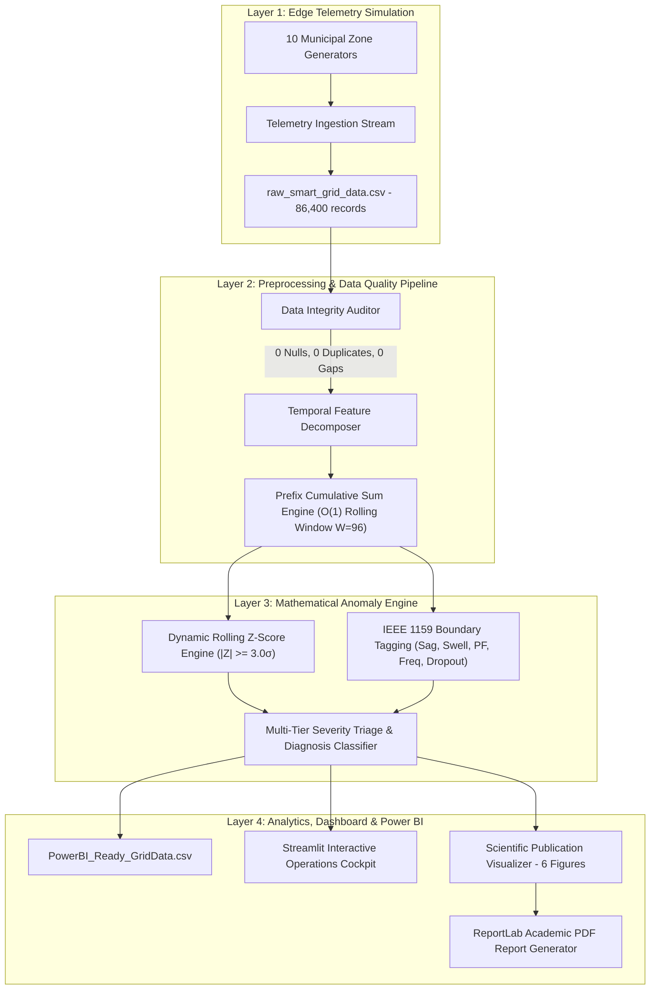
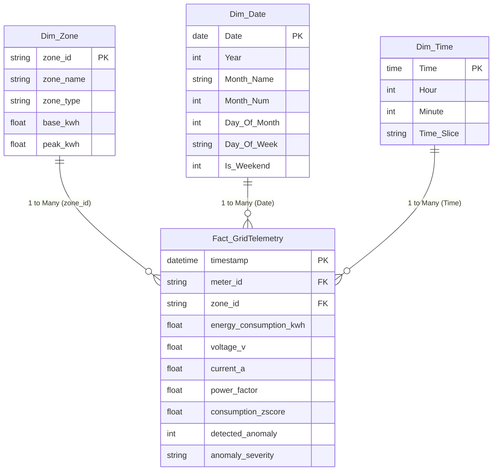

# Smart Grid IoT System Architecture & Technical Specifications

**Course:** BIS586 - 5th Semester ISE Minor Project (Section A)  
**Academic Standards:** IEEE 1159 (Power Quality Monitoring) & ACM SIGENERGY Research Guidelines  

---

## 1. System Architecture Overview

The system processes high-frequency edge smart meter telemetry through a four-stage decoupled pipeline:



---

## 2. Mathematical Formulations

### 2.1 Constant-Time $O(1)$ Sliding Window Statistics
Standard naive sliding window computation over $N$ observations with window size $W$ takes $O(N \cdot W)$ time. To achieve edge-deployable $O(1)$ constant execution time per time-step, prefix cumulative sums are utilized:

$$S_t = \sum_{k=1}^t x_k, \qquad S_t^{(2)} = \sum_{k=1}^t x_k^2$$

$$\mu_{t, W} = \frac{S_t - S_{t-W}}{W}$$

$$\sigma_{t, W} = \sqrt{\max\left(0, \frac{S_t^{(2)} - S_{t-W}^{(2)}}{W} - \mu_{t, W}^2\right)}$$

Where:
* $x_t$ is active power consumption ($\text{kWh}$) at 15-minute time-step $t$.
* $W = 96$ time-steps (representing a full 24-hour diurnal cycle).
* $\max(0, \cdot)$ prevents floating-point numerical precision cancellation.

### 2.2 Dynamic Rolling Standard Score (Z-Score)
To handle non-stationary diurnal human load cycles, each observation is normalized relative to its localized moving 24-hour baseline:

$$Z_t = \frac{x_t - \mu_{t, W}}{\sigma_{t, W} + \epsilon}$$

Where $\epsilon = 10^{-6}$ provides numerical stabilization against division by zero during zero-variance or constant idle loads.

### 2.3 Decision Thresholds
* **Normal Operating State:** $|Z_t| < 2.0\sigma$
* **Statistical Warning Band:** $2.0\sigma \le |Z_t| < 3.0\sigma$
* **Critical Statistical Outlier:** $|Z_t| \ge 3.0\sigma$ ($99.73\%$ confidence under Gaussian distribution)

---

## 3. IEEE 1159 Power Quality Boundary Rules

In addition to active load statistical outliers, telemetry is evaluated against physical electromagnetic limits defined in **IEEE 1159**:

| Failure Mode | Physical Condition | Grid Consequence |
| :--- | :--- | :--- |
| **Voltage Sag** | $V_t < 207.0\text{ V RMS}$ ($-10\%$ below nominal $230\text{V}$) | Motor stalling, brownouts, contactor dropout |
| **Voltage Swell** | $V_t > 253.0\text{ V RMS}$ ($+10\%$ above nominal $230\text{V}$) | Insulation degradation, surge arrester stress |
| **Frequency Instability** | $|f_t - 50.0\text{ Hz}| > 0.4\text{ Hz}$ | Generator trip risk, grid desynchronization |
| **Low Power Factor** | $\text{PF}_t < 0.80$ | Excessive reactive current, feeder $I^2R$ heating |
| **Power Dropout / Telemetry Outage** | $x_t < 0.5\text{ kWh} \land \mu_{t, W} > 5.0\text{ kWh}$ | Feeder open-circuit, meter communication loss |

---

## 4. Business Intelligence: Microsoft Power BI Star Schema

The preprocessed data output [`data/processed/PowerBI_Ready_GridData.csv`](../data/processed/PowerBI_Ready_GridData.csv) directly maps to a high-performance **Star Schema**:



### Core DAX Measures

```dax
// 1. Overall Anomaly Rate
Anomaly Rate (%) = 
DIVIDE(
    CALCULATE(COUNTROWS(Fact_GridTelemetry), Fact_GridTelemetry[detected_anomaly] = 1),
    COUNTROWS(Fact_GridTelemetry),
    0
) * 100

// 2. Voltage Compliance Rate (IEEE 1159)
Voltage Compliance (%) = 
100 - (
    DIVIDE(
        CALCULATE(COUNTROWS(Fact_GridTelemetry), Fact_GridTelemetry[is_voltage_violation] = 1),
        COUNTROWS(Fact_GridTelemetry),
        0
    ) * 100
)

// 3. Peak-to-Average Ratio (PAR)
PAR = 
DIVIDE(
    MAX(Fact_GridTelemetry[energy_consumption_kwh]),
    AVERAGE(Fact_GridTelemetry[energy_consumption_kwh]),
    0
)
```
